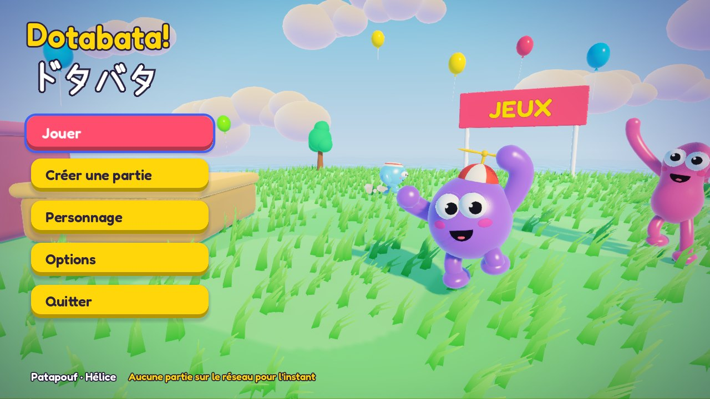
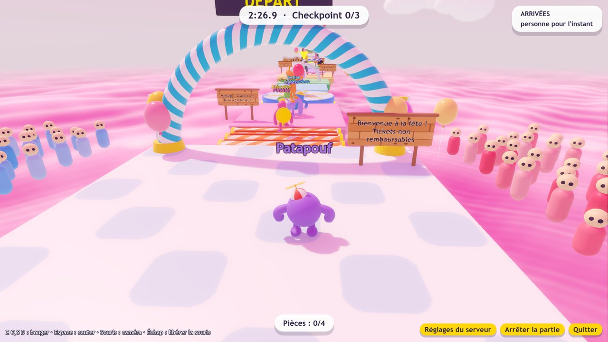
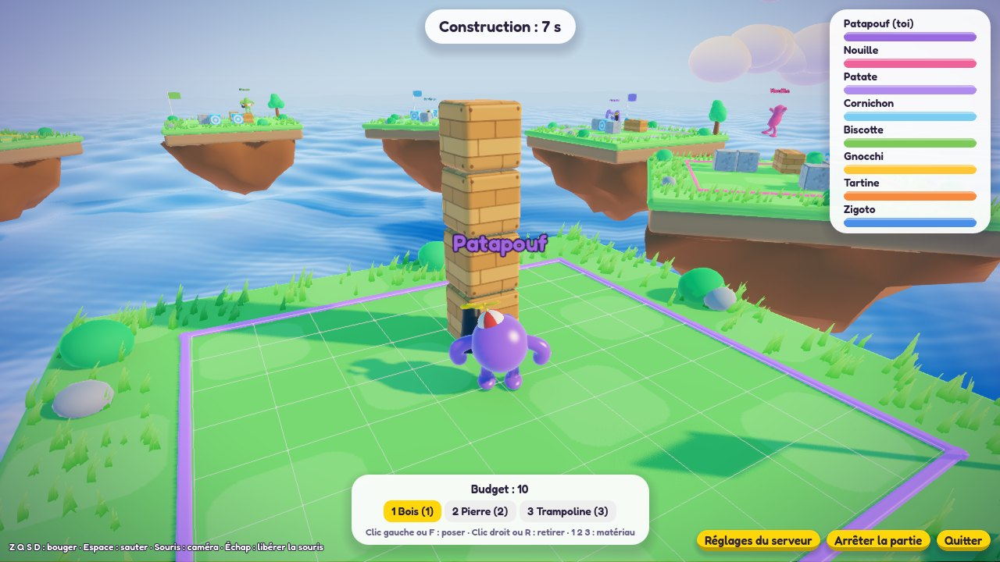
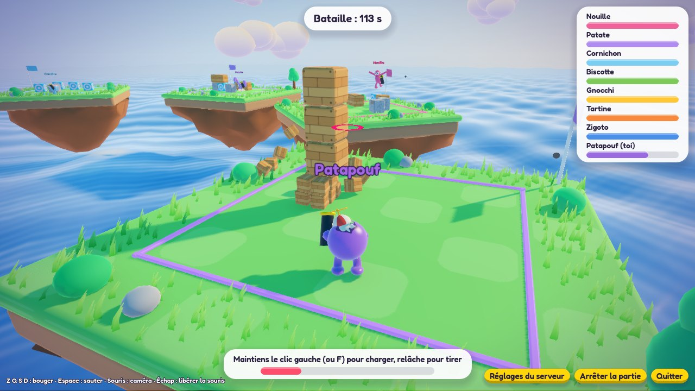
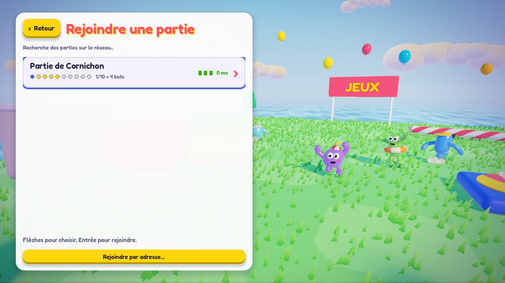
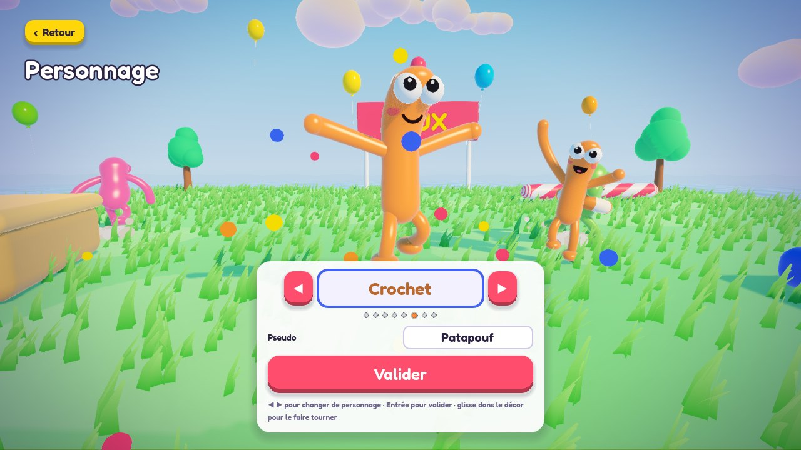
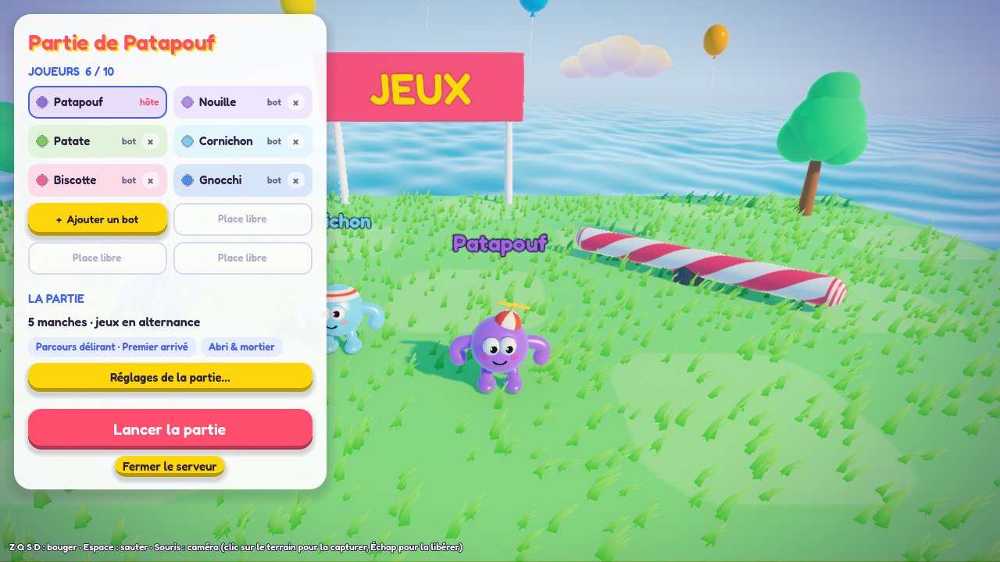
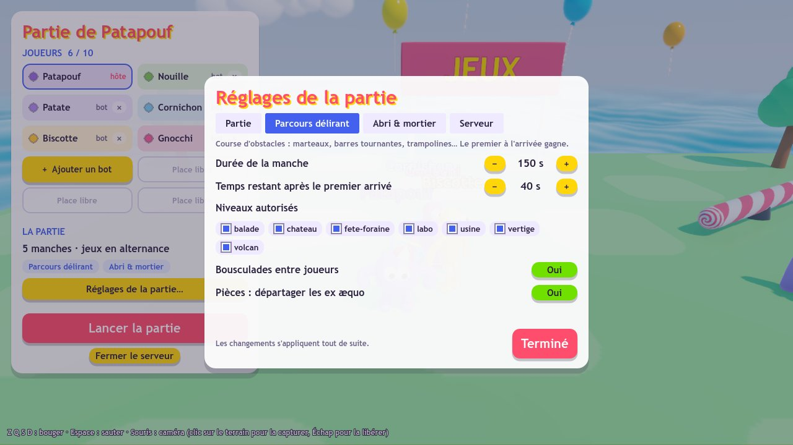

# 🎉 Dotabata! — party game LAN 3D

Party game pour 2 à 10 joueurs sur le même réseau local. **Un seul programme** : chacun lance le jeu, l'un d'eux crée une partie depuis le menu, les autres la voient apparaître dans leur liste et la rejoignent. Une partie enchaîne des manches de mini-jeux (10–15 min au total) avec classement cumulé et podium final.



*Dotabata* (ドタバタ) : en japonais, le chahut maladroit, tout le monde qui court et trébuche dans tous les sens.

Deux mini-jeux pour l'instant :

- **Parcours délirant** — course d'obstacles avec checkpoints, 7 niveaux : *balade*, *usine*, *vertige*, *fete-foraine*, *volcan*, *labo*, *chateau*. Éléments :
  - sols : plateformes, glace, tapis roulants, dalles friables, plateformes mobiles, rouleaux, plateaux tournants, grande roue, pistons, dalles clignotantes, boue, gélatine, rampes et toboggans, speed pads, bulles ;
  - obstacles : marteaux, barres tournantes, balayeurs, canons pousseurs, poinçonneurs, guillotines, boules de démolition, étaux, boules qui dévalent, lave / eau / acide ;
  - propulseurs et zones : trampolines (simples ou directionnels), ventilateurs, canons à joueurs, tyroliennes, téléporteurs, zones lunaires, rafales ;
  - interactions : boutons et portes, leviers et trappes, dalles mémoire piégées, boîtes surprise (super saut, bouclier, banane, gant de boxe), pièces ;
  - décor : arbres, ballons, foule, panneaux, brouillard, faux murs (raccourcis secrets).

  Deux **modes** : *Premier arrivé* (le premier à franchir l'arrivée gagne ; les autres ont encore un peu de temps pour finir) ou *Meilleur temps* (pendant toute la manche, on refait le parcours autant qu'on veut : chaque arrivée renvoie au départ au bout de 3 s, et seul le meilleur essai compte). À tout moment, on peut revenir au dernier checkpoint (R) ou recommencer au départ (T), ce qui relance le chrono de l'essai en mode meilleur temps. Une fois arrivé, on devient un fantôme : on ne bouscule plus ceux qui arrivent et, en mode premier arrivé, une chute ramène sur l'arrivée.

  Réglages de la manche en plus du mode, de la durée et des niveaux : **Bousculades entre joueurs** (on peut faire trébucher en fonçant sur quelqu'un ; désactivé = on se traverse) et **Pièces : départager les ex æquo**.

  
- **Abri & mortier** — chacun construit un abri sur son île flottante, puis bombarde les voisins au mortier. Dernier survivant gagne.

   

Le jeu est écrit avec Godot 4 : voir [godot/README.md](godot/README.md) pour le lancer depuis les sources, ses options et l'export.

## Jouer

Sous Windows, à la racine du dépôt :

- `compiler.cmd` (double-clic) compile le jeu en un seul exe, `godot/build/windows/Dotabata.exe` (`compiler.cmd web` fait aussi la version web). Il faut Godot 4.7 (`winget install GodotEngine.GodotEngine`) ; s'il manque ses modèles d'export, le script propose de les télécharger (environ 1,3 Go, une seule fois). Ferme le jeu avant de recompiler ;
- `lancer.cmd` (double-clic) ouvre le jeu : l'exe compilé s'il existe, sinon Godot sur les sources.

L'exe compilé se suffit à lui-même : c'est le seul fichier à copier sur les PC des joueurs, rien d'autre à installer pour jouer (ni Godot, ni Node). Il lui faut Windows 64 bits et une carte graphique compatible Vulkan ou Direct3D 12 (presque tous les PC récents). L'exe n'étant pas signé, Windows SmartScreen peut afficher « Windows a protégé votre ordinateur » : « Informations complémentaires » puis « Exécuter quand même ». Tous les joueurs doivent avoir la même version. Recompile après chaque modification du jeu ou ajout de niveau, ou télécharge l'exe d'une version publiée (voir [Publier une version](#publier-une-version)).

### Le menu

 

Le menu principal s'ouvre sur l'écran titre, avec ton personnage qui danse dans le décor :

- **Jouer** : les parties du réseau local, trouvées toutes seules (nom, places, « en partie », mot de passe, ping), ou **Rejoindre par adresse** (`192.168.1.20:3000`) pour une partie d'un autre sous-réseau ou derrière un VPN ;
- **Créer une partie** : nom, nombre de joueurs maximum, mot de passe facultatif ;
- **Personnage** : choix parmi les 8 personnages et pseudo ;
- **Options** : graphismes, plein écran, volume des effets, sensibilité de la souris, boutons de la manette ;
- **Quitter**.

Tout se pilote à la souris, au clavier (flèches, Entrée, Échap pour revenir) ou à la manette.

### Le lobby



Le panneau du lobby montre une case par place : les joueurs (l'hôte, toi, les bots), puis les places libres. Celui qui crée la partie en est l'hôte : il ajoute un bot dans la première place libre ou retire un bot précis (croix sur sa carte), et lance la partie. En dessous, un résumé de la partie (manches, ordre, jeux) et le bouton **Réglages de la partie…**, qui ouvre une fenêtre à onglets : *Partie* (nombre de manches, ordre des jeux — alterné, aléatoire ou choisi manche par manche —, jeux inclus), un onglet par jeu (niveaux autorisés et réglages propres au jeu) et *Serveur*. Les autres joueurs voient les mêmes réglages en lecture seule. Le pseudo, le personnage et les graphismes se changent dans le menu principal.



Les **réglages du serveur** (nom, joueurs max, mot de passe) se changent à tout moment, même avec des joueurs connectés et en pleine manche (onglet Serveur au lobby, bouton « Réglages du serveur » en bas à droite pendant une manche). Baisser le maximum n'expulse personne : ça ferme seulement la porte aux nouveaux.

Quitter le jeu ou « Fermer le serveur » arrête la partie pour tout le monde (les autres reviennent au menu avec un message).

À la première partie créée, Windows demande d'autoriser Dotabata! sur le réseau : accepte pour les **réseaux privés**, sinon les autres PC ne le verront pas. Le serveur utilise le port 3000 (TCP pour le jeu, UDP pour la découverte), ou le suivant libre jusqu'à 3009.

Les valeurs de départ des réglages sont dans [godot/config/defaults.json](godot/config/defaults.json) ; les derniers réglages de l'hôte sont mémorisés dans le dossier utilisateur du jeu (`%APPDATA%\Godot\app_userdata\Dotabata!\`).

### Commandes

| Action | Clavier et souris | Manette (par défaut) |
| --- | --- | --- |
| Bouger | Z Q S D (les touches sont lues par position : W A S D sur un clavier QWERTY) | Stick gauche |
| Sauter | Espace | A |
| Parcours — utiliser l'objet tenu | E ou clic droit | X |
| Parcours — revenir au dernier checkpoint | R | LB |
| Parcours — recommencer au départ | T | Select |
| Caméra | Souris (clic sur le jeu pour la capturer, Échap pour la libérer) ou flèches | Stick droit |
| Mortier — construire | Clic gauche ou F : poser · clic droit ou R : retirer · 1 2 3 : matériau | RT : poser · LT : retirer · Y : matériau suivant |
| Mortier — tirer | Maintenir le clic gauche (ou F) pour charger, relâcher pour tirer | Maintenir RT, relâcher pour tirer |
| Menus | Flèches, Entrée, Échap | Croix ou stick gauche, A : valider, B : retour |
| Lobby — régler la partie | Souris (Échap ferme la fenêtre des réglages) | Start, puis croix pour choisir, A pour valider, LB / RB pour changer d'onglet, B ou Start pour fermer la fenêtre puis revenir au terrain |

Les boutons de la manette se changent dans **Options → Configurer la manette** (avec la vitesse de la caméra au stick et l'inversion de l'axe vertical).

## Publier une version

Pousser un tag de version fait compiler l'exe par GitHub (workflow [.github/workflows/exe.yml](.github/workflows/exe.yml)) et le publie dans l'onglet **Releases** du dépôt, prêt à télécharger :

```bash
git tag v1.2.0
```

```bash
git push origin v1.2.0
```

Le numéro (forme `v1.2.3`) est inscrit dans les propriétés de l'exe et affiché en bas de l'écran titre. Chaque pull request est aussi compilée (l'exe est alors dans les artefacts du workflow, onglet **Actions**), et on peut lancer une compilation à la main depuis cet onglet.

## Développement

Le jeu (client **et** serveur) est dans `godot/`. Les sources TypeScript qui restent servent au serveur MCP de niveaux et de référence aux tests de parité de la physique.

```bash
npm install
```

```bash
npm test
```

- `npm test` — tests vitest de la référence TypeScript : physique, schéma et validation des niveaux, scores, balistique.
- `npm run typecheck` — vérification TypeScript.
- `npm run golden` — régénère les vecteurs de référence des tests de parité Godot (à relancer après une modification de `shared/src/` ou de `games/*/shared.ts`).
- Les tests du jeu et du serveur (parties complètes jouées par des bots sur chaque niveau, règles du parcours, connexion réelle avec mot de passe et découverte LAN) se lancent avec Godot : voir [godot/README.md](godot/README.md).

## Architecture

```
godot/            le jeu : client (rendu, personnages, interface) et serveur intégré
godot/server/     serveur : session (lobby, manches, scores), règles serveur des mini-jeux, bots, découverte LAN
godot/sim/        physique maison, cinématique des obstacles, règles partagées (portées à l'identique du TypeScript)
godot/levels/parkour/*.json   niveaux de parcours (livrés dans l'exe)
compiler.cmd, lancer.cmd      compiler l'exe, lancer le jeu (Windows)
.github/workflows/exe.yml     compilation sur GitHub : exe des pull requests, versions publiées à chaque tag
docs/captures/    captures d'écran du README
shared/src/       référence TypeScript : physique, format + validation des niveaux, scores
games/<id>/shared.ts          référence TypeScript des règles partagées de chaque mini-jeu
mcp/src/          serveur MCP pour créer des niveaux
tests/            tests vitest de la référence TypeScript
```

Principes réseau, pensés pour le LAN :

- **Le serveur tourne dans l'exe de l'hôte**, qui s'y connecte lui-même en WebSocket comme n'importe quel joueur. Les autres le trouvent par une requête UDP diffusée sur le réseau local.
- **Chaque client simule son propre personnage** avec la physique partagée et envoie son état 30 fois par seconde : réactivité parfaite, sans prédiction ni réconciliation. Les autres joueurs sont interpolés.
- **Le serveur fait autorité sur les règles** : phases, chronos, checkpoints, arrivées, obus, destruction des blocs, dégâts, scores. Il simule aussi les bots.
- **Les obstacles sont déterministes** : leur position est une fonction pure de l'horloge serveur synchronisée, donc rien à synchroniser.

Le rendu est entièrement procédural (aucune texture ni modèle à charger). Les dégâts sont visibles sans une goutte de sang : chaque personnage a un squelette cartoon sous sa peau, et le shader de la peau efface les fragments autour des points d'impact. À 0 PV il ne reste qu'un tas d'os (et un petit air de xylophone).

## Ajouter un mini-jeu

1. Écris sa fiche (nom, description, réglages : chaque réglage déclare son type, sa valeur par défaut et ses bornes — le lobby génère le formulaire tout seul) dans [godot/server/metas.gd](godot/server/metas.gd), et la même dans `games/<id>/shared.ts` + [games/registry.ts](games/registry.ts) (les tests de parité vérifient qu'elles sont identiques).
2. Écris sa partie serveur dans `godot/server/games/<id>_server.gd` : une classe qui hérite de `ServerGame` ([godot/server/server_game.gd](godot/server/server_game.gd)) avec `on_start`, `on_tick`, `on_player_message`, `on_player_leave`, `get_results`, et `bot_tick` si tu veux des bots ; inscris-la dans `GameMetas.create_game`.
3. Écris sa partie client dans `godot/games/<id>/` (une classe `ClientGame`) et inscris-la dans [godot/core/registry.gd](godot/core/registry.gd).

Le cœur fournit le reste : personnage, caméra, réseau, `ctx.damage()` pour marquer la peau d'un joueur, `ctx.impulse()` pour l'envoyer valser, scores et enchaînement des manches.

## Créer des niveaux de parcours avec le MCP

Le dépôt contient un serveur MCP déclaré dans [.mcp.json](.mcp.json) : ouvre le dossier avec Claude Code, accepte le serveur `jeux-niveaux`, puis demande par exemple « crée un niveau de parcours difficile avec trois marteaux et un passage sur la glace ».

Outils disponibles : `list_levels`, `get_level`, `get_element_catalog`, `create_level`, `update_level`, `add_elements`, `remove_elements`, `validate_level`, `preview_level`, `delete_level`.

Le MCP écrit dans `godot/levels/parkour/` (la variable `JEUX_LEVELS_DIR` change ce dossier). `validate_level` utilise le schéma et la physique du jeu : il vérifie qu'il y a un départ et une arrivée, que chaque saut est à portée du personnage (avec 15 % de marge) et que les checkpoints s'enchaînent. Un serveur lancé depuis les sources voit un niveau enregistré apparaître dans le lobby sans redémarrer ; un niveau non terminable n'est jamais proposé en jeu. Pour l'exe exporté, les niveaux sont livrés dedans : réexporte après en avoir ajouté, ou dépose les fichiers `.json` dans `%APPDATA%\Godot\app_userdata\Dotabata!\levels\parkour\` (ils s'ajoutent aux niveaux livrés).

On peut aussi écrire les fichiers à la main — le format est décrit par `get_element_catalog` et par [shared/src/level.ts](shared/src/level.ts).

## Limites connues

- La physique est maison (capsule contre boîtes). Elle suffit pour ces deux jeux ; un futur jeu qui demanderait de vrais empilements ou des véhicules devra brancher un vrai moteur.
- Un joueur qui arrive en cours de partie attend la manche suivante.
- Les clients sont de confiance (chacun annonce sa propre position) : c'est un jeu entre amis, pas un jeu en ligne compétitif.
- La version web du jeu ne peut pas héberger de serveur (un navigateur n'ouvre pas de port) : elle rejoint seulement par adresse.
